# Hi there, I'm Dannr! 👋

🎓 Computer Science student at Hunan University.  
🌱 Keep learning, keep exploring, keep building.

## 👨‍💻 About Me

- 💻 Passionate about programming, software development, and creative projects.
- 🚀 Enjoy turning ideas into real, usable applications.
- 🌐 Interested in web development, mobile app development, game development, and AI agents.
- 📚 Always learning new things and improving my skills along the way.

## 📊 Languages Stats

<picture>
  <source media="(prefers-color-scheme: dark)" srcset="./profile/top-langs-dark.svg">
  <source media="(prefers-color-scheme: light)" srcset="./profile/top-langs-light.svg">
  
</picture>

  
## 🚀 Projects  

### 🚇 MetroWordle
A collection of transit-themed mini-games that combine urban transportation knowledge with interactive gameplay.

---
### 📖 NovelTranslator
A specialized AI agent workspace for long-form novel translation.

---
### 🍊 OrangeOrganize
A fully offline Android class schedule app with no ads and no account required.

---
### 🔔 Soren
Aan AI-powered Android notification manager that uses LLMs to automatically identify, organize, and turn notifications into calendar events.

*Stay curious. Keep building.* ✨
